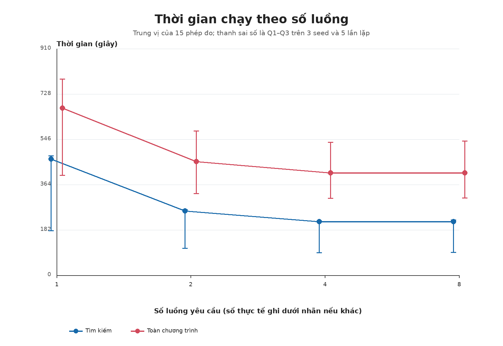
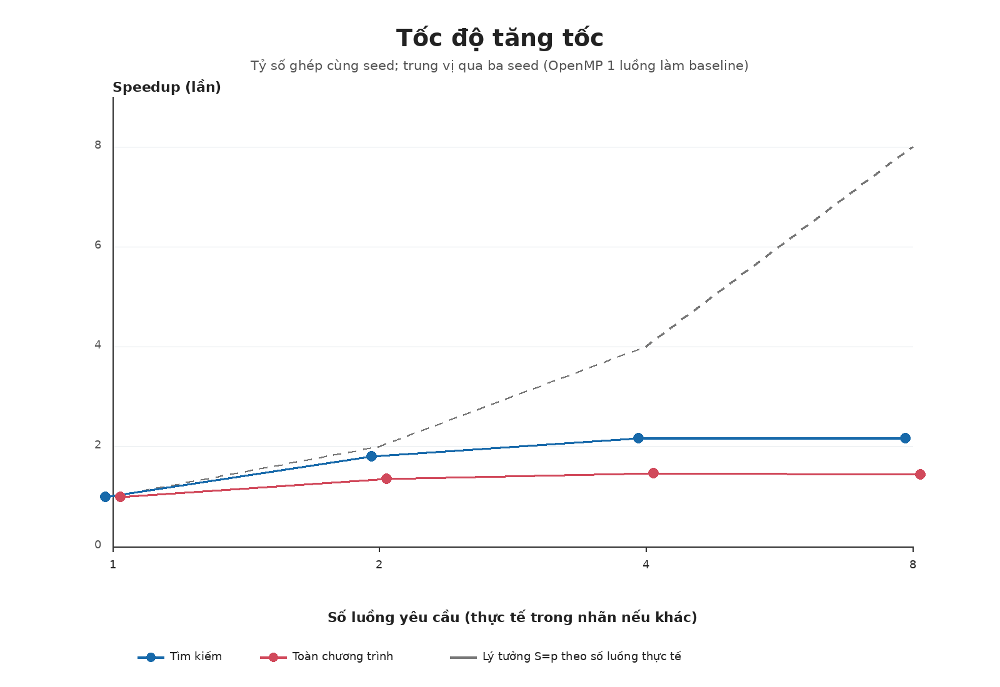
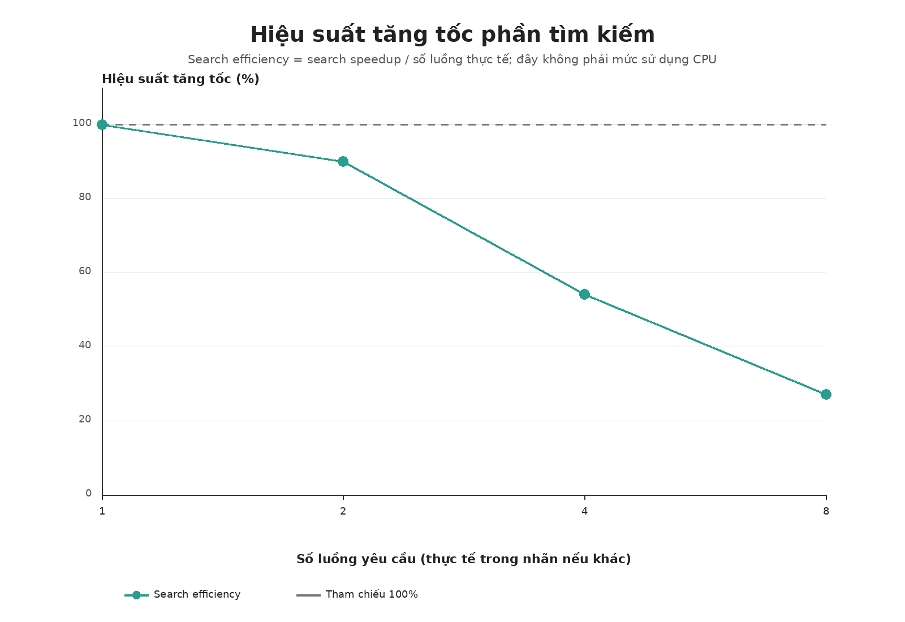
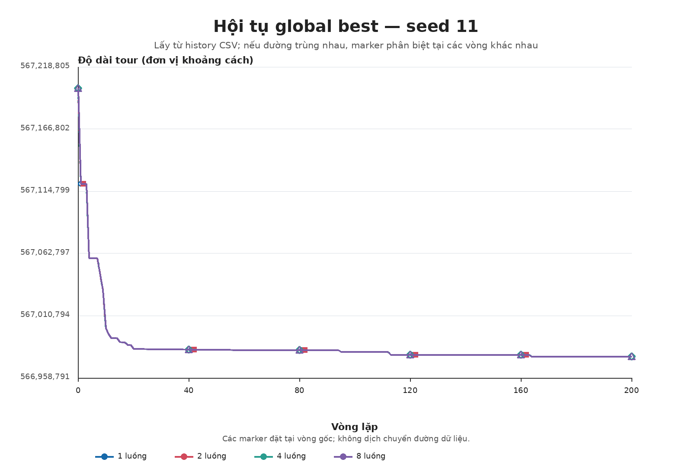

# Báo cáo benchmark OpenMP trên `Tnm30001.tsp`

Đợt đo bắt đầu ngày **15-11-2026** theo `created_local` trong [metadata.json](metadata.json). Dữ liệu thô, cấu hình, hash, tour và lịch sử nằm cùng thư mục với báo cáo. [raw.csv](raw.csv) chứa 64 lần chạy: 4 warm-up và 60 phép đo; [summary.csv](summary.csv) tổng hợp 15 phép đo cho mỗi mức luồng.

## Môi trường và cách đo

- Ubuntu 24.04.5 LTS, kernel Linux 7.0.0-42-generic.
- Intel Core i3-4030U @ 1.90 GHz, **2 lõi vật lý / 4 CPU logic**, RAM 7.65 GiB.
- GCC 13.3.0, CMake 3.28.3, C++17; bản Release bật OpenMP (`_OPENMP=201511`). Cờ biên dịch: `-O3 -DNDEBUG -std=c++17 -Wall -Wextra -Wpedantic -Wshadow -fopenmp`.
- Cùng binary OpenMP Release, SHA256 `9401d1720b26d49b8dbcaf0335b26291ab820d662ba0a74af96beb179e020262`. SHA256 input `f19dd50c90d2dff595cddb99dbc7d1c2169a22dd0e67ad0db8fa333aa4c222ca`.
- Mỗi lần chạy dùng 128 kiến, 200 vòng, 4 nghiệm khởi tạo, lịch `dynamic`, local search bật, seed 11/22/33. Các tham số khác cố định: candidate size 16, backup size 64, min new edges 8, local-search size 20, rho 0.5, beta 1, p-best 0.1, global-best probability 0.01, bounds `paper`. Log tiến độ, profiler và verify trong solver đều tắt.
- Một warm-up cho từng mức 1/2/4/8 luồng, không đưa vào thống kê; sau đó năm phép đo cho từng cặp seed/luồng. Mỗi seed có 20 phép đo, mỗi mức luồng có 15 phép đo. Các lần chạy tuần tự, thứ tự mức luồng xoay theo lượt lặp và seed.
- Runtime thực tế tạo đủ 1, 2, 4, 8 luồng. **8 luồng là oversubscription**, vì máy chỉ có 4 CPU logic; không phải phép đo trên 8 lõi phần cứng.

Thời gian tính bằng giây. Median và Q1–Q3 gộp 15 phép đo thuộc ba seed ở mỗi mức luồng; Q1 và Q3 dùng nội suy tuyến tính, IQR = Q3 − Q1. Khoảng Q1–Q3 mô tả độ phân tán, không phải khoảng tin cậy. Speedup tính riêng từng seed: lấy trung vị năm lần chạy của baseline OpenMP một luồng chia cho trung vị ở cấu hình tương ứng, rồi lấy trung vị ba tỷ số. Vì vậy speedup không nhất thiết bằng tỷ số hai trung vị gộp trong bảng. Search efficiency = search speedup / số luồng thực tế; không phải phần trăm sử dụng CPU.

## Kết quả

| Luồng yêu cầu / thực tế | Preprocess median | Init median | Search median [Q1–Q3] | Total median [Q1–Q3] | Search speedup | Total speedup | Search efficiency |
|---:|---:|---:|---:|---:|---:|---:|---:|
| 1 / 1 | 1.168 | 216.479 | 466.989 [178.705–479.550] | 671.317 [401.503–788.066] | 1.000× | 1.000× | 100.0% |
| 2 / 2 | 1.146 | 215.985 | 259.086 [108.471–264.017] | 456.437 [327.819–579.320] | 1.802× | 1.356× | 90.1% |
| 4 / 4 | 1.128 | 216.835 | 215.604 [90.370–218.255] | 411.389 [308.721–534.050] | 2.166× | 1.469× | 54.1% |
| 8 / 8 | 1.107 | 216.220 | 215.239 [91.826–221.261] | 411.538 [310.320–539.086] | 2.170× | 1.440× | 27.1% |

Độ dài tour cuối theo `raw.csv`:

| Seed | Độ dài tour cuối | Số phép đo | Biến thiên theo luồng/lần lặp |
|---:|---:|---:|---|
| 11 | 566.976.723 | 20 | Không, cả 4 mức luồng và 5 lần lặp cùng độ dài |
| 22 | 566.978.141 | 20 | Không, cả 4 mức luồng và 5 lần lặp cùng độ dài |
| 33 | 566.975.816 | 20 | Không, cả 4 mức luồng và 5 lần lặp cùng độ dài |

Chất lượng khác nhau giữa các seed; tour ngắn nhất trong các phép đo là **566.975.816** ở seed 33. Không có biến thiên độ dài giữa các lần lặp hay mức luồng trong cùng seed. Cột `best_length` của `summary.csv` đều ghi 566976723; không dùng giá trị đó làm độ dài nhỏ nhất của toàn bộ ba seed.

Search có trung vị gộp thấp nhất ở 8 luồng, nhưng chỉ thấp hơn 4 luồng khoảng **0.17%**. Total có trung vị thấp nhất ở 4 luồng; 8 luồng cao hơn khoảng **0.04%**. Các khoảng Q1–Q3 chồng lấn rộng, nên loạt đo này không chứng minh 8 luồng nhanh hơn 4 luồng một cách ổn định. Hiệu suất search giảm từ 54.1% ở 4 luồng xuống 27.1% ở 8 luồng; đây là chỉ số speedup trên số luồng, không phải CPU utilization.

Độ phân tán gộp lớn còn đi cùng khác biệt thời gian rõ giữa seed: ở một luồng, trung vị search của seed 11/22/33 lần lượt là 466.989 / 480.488 / 178.230 giây. Vì vậy không nên diễn giải toàn bộ IQR là nhiễu hệ thống hay quy nguyên nhân cho oversubscription. Chưa có phép đo riêng xác định nguyên nhân của khác biệt này.

Trung vị khởi tạo ở các cấu hình đều khoảng 216 giây, trong khi search giảm khi tăng từ 1 lên 4 luồng. Phần thời gian ngoài search vẫn đáng kể; speedup total vì thế thấp hơn speedup search trong số liệu nhiều luồng. Trung vị các thành phần không nhất thiết cộng thành trung vị total.

## Đồ thị

Mỗi hình có bản SVG cùng tên trong `figures/`. Đồ thị hội tụ minh họa seed 11; không đại diện cho chất lượng của cả ba seed. Nguồn tour và lịch sử từng lần chạy nằm trong `runs/`.

## Kiểm chứng và giới hạn

`metadata.json` ghi kết quả **`PASS: independent tour, length, complete-history and matched-workload comparison`**. Khi hoàn thiện báo cáo, kiểm chứng độc lập được chạy lại bằng `python3 scripts/verify_results.py --input data/Tnm30001.tsp --results results/Tnm30001` và đạt **PASS cho 64 tour**, gồm cả warm-up: tour hợp lệ, độ dài tính lại chính xác, lịch sử đầy đủ và tour/lịch sử giống nhau cho cùng workload thuật toán. Script kiểm tra tour là hoán vị của các đỉnh input, tính độ dài cạnh Euclid làm tròn, đối chiếu tour xuất ra, kiểm tra lịch sử từ vòng 0 đến 200 và best length không tăng. Các seed được xác nhận là 11/22/33; luồng yêu cầu/thực tế lần lượt 1/1, 2/2, 4/4, 8/8. Không suy ra kết quả CTest từ báo cáo khác.

Đây chỉ là một instance 30.001 đỉnh, ba seed và một budget cố định. Metadata không ghi thiết lập affinity hoặc kiểm soát nhiệt độ CPU; không có cơ sở tách riêng ảnh hưởng hệ thống khỏi khác biệt thời gian giữa seed. Trường `output_directory` trong metadata đã cập nhật theo tên thư mục mới; lệnh trong `raw.csv` giữ nguyên đường dẫn lúc đo làm bằng chứng lịch sử. Kết quả oversubscription chỉ mô tả máy và cấu hình này, không phải khuyến nghị chung về số luồng. FACO là heuristic; tour hợp lệ và độ dài được kiểm tra không chứng minh tối ưu.
