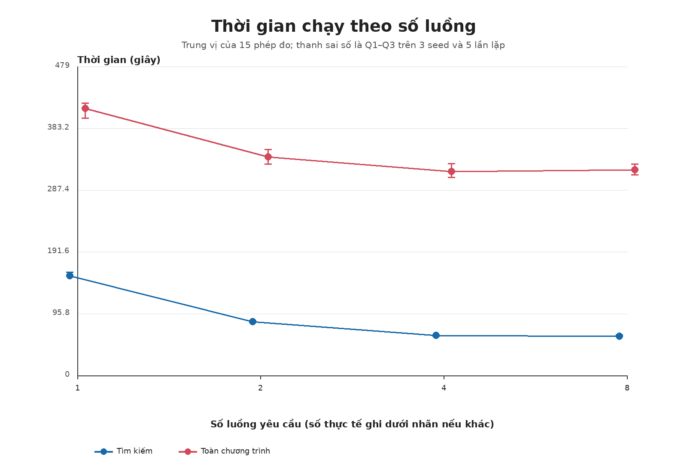
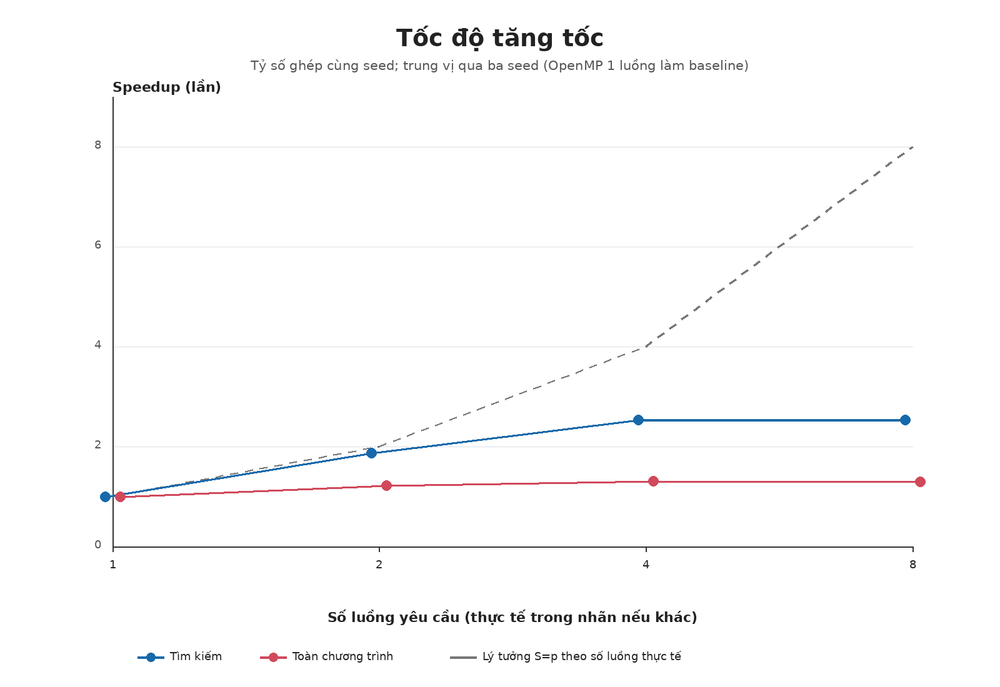
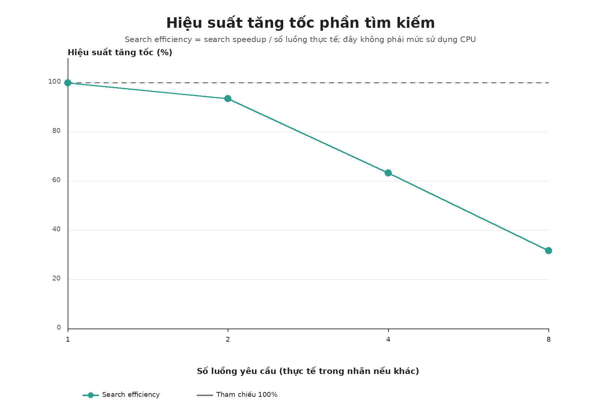
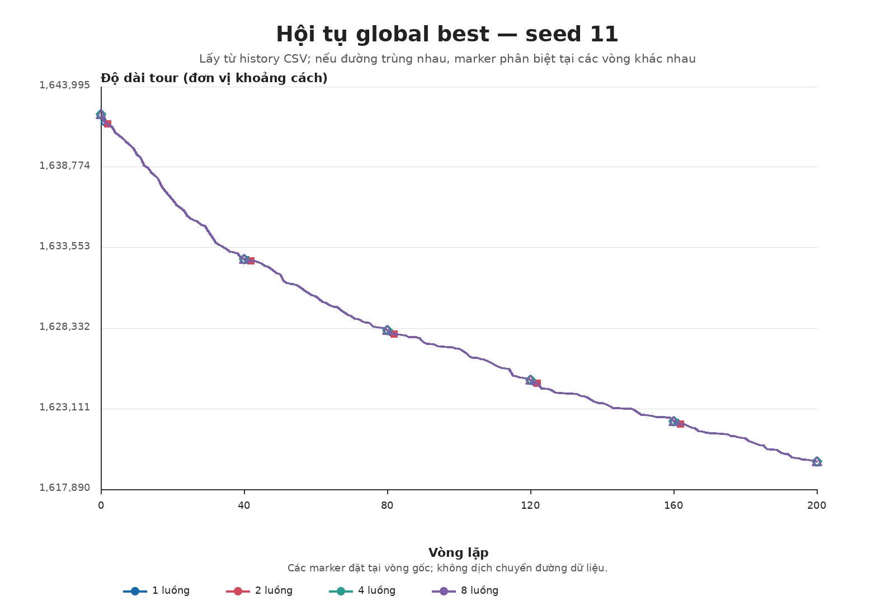

# Báo cáo benchmark OpenMP trên `d15112.tsp`

Ngày bắt đầu đo theo `metadata.json`: **14-11-2026**, lúc 23:25:52 (UTC+07:00). Dữ liệu thô, cấu hình, hash, tour và lịch sử nằm cùng thư mục với báo cáo. `raw.csv` có 64 dòng chạy, gồm 4 warm-up và 60 phép đo; `summary.csv` tổng hợp 15 phép đo cho mỗi mức luồng.

## Môi trường và cách đo

- Ubuntu 24.04.5 LTS, kernel Linux 7.0.0-42-generic.
- Intel Core i3-4030U @ 1.90 GHz, **2 lõi vật lý / 4 CPU logic**, RAM 7.65 GiB.
- GCC 13.3.0, CMake 3.28.3, C++17; build Release, OpenMP bật (`_OPENMP=201511`). Cờ biên dịch: `-O3 -DNDEBUG -std=c++17 -Wall -Wextra -Wpedantic -Wshadow -fopenmp`.
- Cùng một binary OpenMP Release, SHA256 `9401d1720b26d49b8dbcaf0335b26291ab820d662ba0a74af96beb179e020262`. SHA256 input `45db9c1bd76685076c5a88f2e0cb3d86da35c2ac6ac027e000ed6cf5d9aca431`.
- Mỗi lần chạy dùng 128 kiến, 200 vòng, 4 nghiệm khởi tạo, lịch `dynamic`, local search bật, seed 11/22/33. Các tham số cố định: candidate size 16, backup size 64, min new edges 8, local-search size 20, rho 0.5, beta 1, p_best 0.1, global-best probability 0.01, bounds `paper`. Log tiến độ, profiler và verify trong solver đều tắt.
- Có một warm-up cho mỗi mức 1/2/4/8 luồng, đều dùng seed 11 và bị loại khỏi thống kê. Mỗi cặp seed/luồng có đúng 5 phép đo. Tổng cộng 64 lần chạy tuần tự, thứ tự luồng xoay theo lượt và seed.
- Runtime thực tế tạo đủ 1, 2, 4, 8 luồng theo yêu cầu. Mức **8 luồng trên 4 CPU logic là oversubscription**, không phải máy có 8 lõi thực thi độc lập.

Thời gian tính bằng giây. Trung vị và khoảng Q1–Q3 trong bảng được tính trên 15 phép đo mỗi mức luồng, gộp ba seed; IQR = Q3 − Q1, không phải khoảng tin cậy. Speedup được tính riêng từng seed: lấy trung vị năm lần chạy ở baseline OpenMP một luồng chia cho trung vị của mức đang xét, rồi lấy trung vị ba tỷ số. Vì vậy speedup không nhất thiết bằng tỷ số hai trung vị gộp trong bảng. Search efficiency = search speedup / số luồng thực tế, không phải phần trăm sử dụng CPU.

## Kết quả

| Luồng yêu cầu / thực tế | Preprocess median | Init median | Search median [Q1–Q3] | Total median [Q1–Q3] | Search speedup | Total speedup | Search efficiency |
|---:|---:|---:|---:|---:|---:|---:|---:|
| 1 / 1 | 0.651 | 253.642 | 154.499 [154.104–159.750] | 414.428 [398.836–421.892] | 1.000× | 1.000× | 100.0% |
| 2 / 2 | 0.632 | 253.347 | 83.194 [82.462–84.814] | 338.737 [327.751–349.987] | 1.871× | 1.219× | 93.6% |
| 4 / 4 | 0.638 | 253.331 | 62.446 [60.788–62.960] | 316.471 [306.992–328.118] | 2.535× | 1.303× | 63.4% |
| 8 / 8 | 0.712 | 254.377 | 60.976 [60.234–62.782] | 318.925 [311.181–327.772] | 2.534× | 1.299× | 31.7% |

IQR search lần lượt là **5.646 / 2.353 / 2.172 / 2.548 giây** ở 1/2/4/8 luồng; IQR total tương ứng là **23.055 / 22.237 / 21.126 / 16.591 giây**.

Độ dài tour cuối trong `raw.csv`, xét cả warm-up và các lần đo:

| Seed | Độ dài tour cuối | Tính ổn định giữa các lần chạy |
|---:|---:|---|
| 11 | 1.619.690 | Cùng độ dài ở cả 4 mức luồng và mọi lần lặp, kể cả warm-up |
| 22 | 1.619.933 | Cùng độ dài ở cả 4 mức luồng và mọi lần lặp |
| 33 | 1.624.751 | Cùng độ dài ở cả 4 mức luồng và mọi lần lặp |

Chất lượng **khác nhau giữa các seed**, nhưng không có biến thiên độ dài cuối trong cùng seed ở loạt dữ liệu này. Cột `best_length` = 1.619.690 trong mỗi dòng `summary.csv` là giá trị tốt nhất của nhóm, không có nghĩa mọi lần chạy đều đạt độ dài đó. Độ dài bằng nhau tự nó không chứng minh tour hoặc toàn bộ lịch sử giống nhau; phần kiểm chứng bên dưới ghi riêng nguồn xác nhận điều này.

Trung vị search thấp nhất là **8 luồng**, thấp hơn 4 luồng khoảng **2.4%**; tuy nhiên search speedup ghép seed cao nhất lại là **4 luồng** (2.535× so với 2.534×), do cách tổng hợp khác nhau. Trung vị total thấp nhất là **4 luồng**; ở 8 luồng, total cao hơn khoảng **0.8%**. Các khoảng Q1–Q3 của 4 và 8 luồng chồng lấn cho cả search lẫn total, nên đây chỉ là so sánh mô tả đợt đo, không chứng minh khác biệt có ý nghĩa thống kê hay lợi ích chung của oversubscription.

Trung vị initialization vẫn khoảng **253–254 giây** ở mọi mức luồng, lớn hơn trung vị search ngay cả ở baseline một luồng. Phần thời gian này không giảm tương ứng với search trong dữ liệu đo, nên mức cải thiện total nhỏ hơn nhiều so với search: tại 4 luồng lần lượt là 1.303× và 2.535×. Không có phép đo ở đây tách được nguyên nhân cụ thể của biến thiên thời gian hoặc chênh lệch nhỏ giữa 4 và 8 luồng.

## Đồ thị

Cả bốn hình đều có bản SVG cùng tên trong `figures/`. Đồ thị hội tụ minh họa seed 11; không dùng hình của một seed để kết luận chất lượng đồng nhất giữa ba seed.

## Kiểm chứng và giới hạn

`metadata.json` ghi trạng thái **`PASS: independent tour, length, complete-history and matched-workload comparison`**. Theo chức năng của `scripts/verify_results.py`, kiểm chứng này bao gồm: tour là hoán vị đủ 15.112 đỉnh; tính lại độ dài theo khoảng cách Euclid làm tròn; lịch sử đầy đủ vòng 0–200, best-so-far không tăng và khớp độ dài cuối; file `.tour` khớp tour JSON; tour và lịch sử giống nhau giữa các lần chạy có cùng workload, kể cả khi khác số luồng hoặc lần lặp. Thư mục `runs/` có 64 JSON chạy, phù hợp 64 dòng `raw.csv`.

Kiểm chứng độc lập đã được chạy lại sau khi đổi tên thư mục bằng `python3 scripts/verify_results.py --input data/d15112.tsp --results results/d15112`, kết quả **PASS 64 tour**, độ dài chính xác, lịch sử đầy đủ và tour/lịch sử giống nhau với cùng workload. Script ghi nhận đủ seed 11/22/33 và các cặp luồng yêu cầu/thực tế 1/1, 2/2, 4/4, 8/8. Báo cáo không khẳng định đã chạy CTest hay kiểm tra cú pháp Python cho thay đổi này. Trường `output_directory` trong metadata đã cập nhật thành `d15112`; lệnh trong `raw.csv` giữ nguyên đường dẫn lúc đo làm bằng chứng lịch sử.

Kết quả chỉ bao phủ một instance, ba seed, một budget 128 kiến × 200 vòng và một máy. Metadata không ghi nhận việc cố định affinity hoặc kiểm soát nhiệt độ CPU; khoảng Q1–Q3 gộp cả khác biệt theo seed và biến thiên giữa các lần đo, không tách được từng nguồn. Kết quả 8 luồng chỉ mô tả cấu hình oversubscription này, không phải khuyến nghị số luồng chung. FACO là heuristic; không có đối chiếu chứng minh tối ưu trong dữ liệu dùng cho báo cáo.
