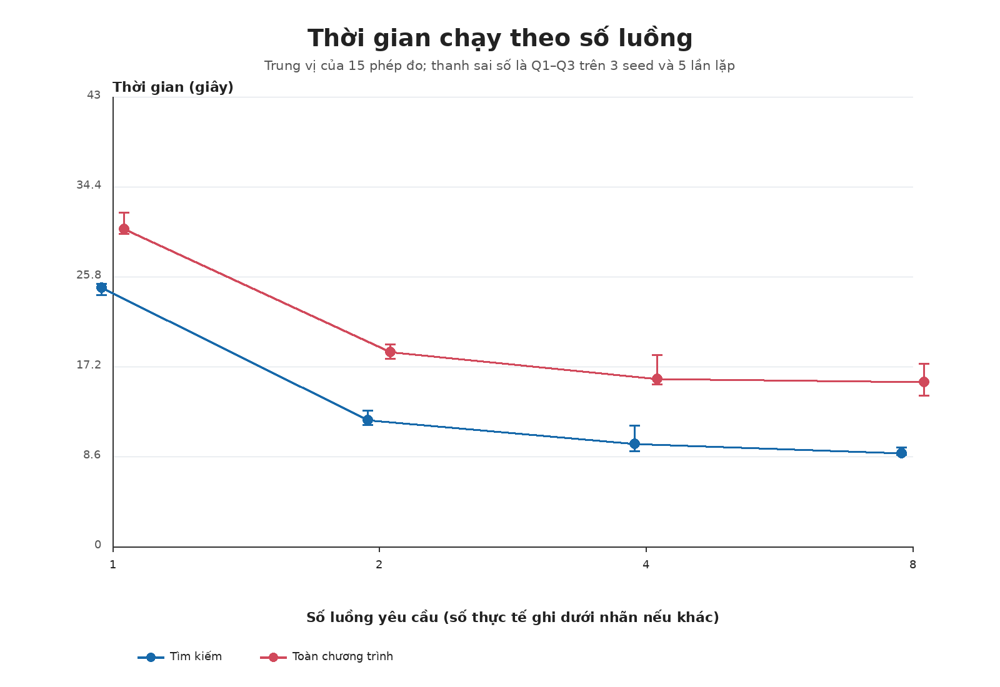
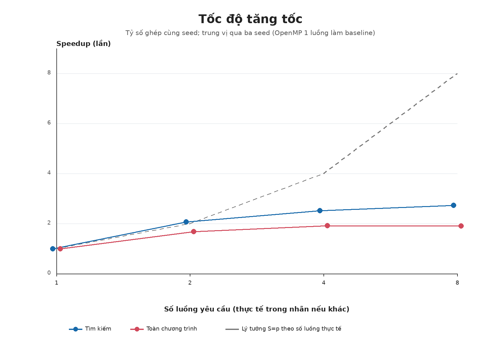
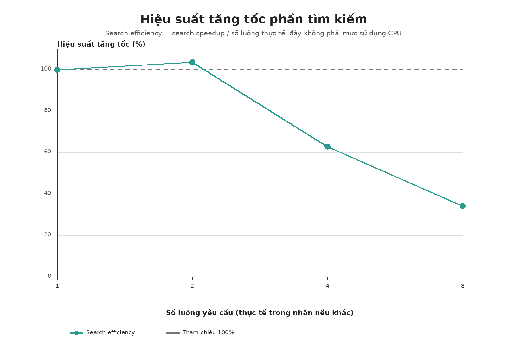
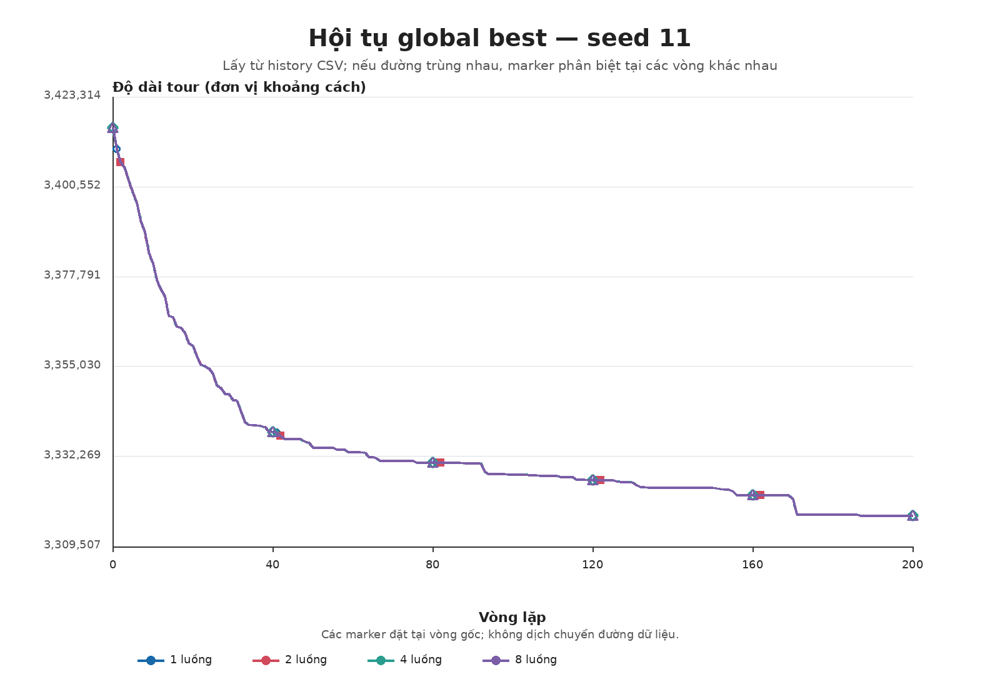

# Báo cáo benchmark OpenMP trên `uniform2048.tsp`

Ngày đo: **14-11-2026**. Dữ liệu thô, cấu hình, hash, tour và lịch sử nằm cùng thư mục với báo cáo; `raw.csv` chứa 15 phép đo cho mỗi mức luồng, còn `summary.csv` lưu thống kê tổng hợp.

## Môi trường và cách đo

- Ubuntu 24.04.5 LTS, kernel Linux 7.0.0-42-generic.
- Intel Core i3-4030U, **2 lõi vật lý / 4 CPU logic**, RAM 7.65 GiB.
- GCC 13.3.0, CMake 3.28.3, C++17; OpenMP bật (`_OPENMP=201511`). Cờ Release: `-O3 -DNDEBUG -std=c++17 -Wall -Wextra -Wpedantic -Wshadow -fopenmp`.
- Cùng một binary OpenMP Release, SHA256 `9401d1720b26d49b8dbcaf0335b26291ab820d662ba0a74af96beb179e020262`. SHA256 input `cc84eb0e7b49fbf95b8a932c42a68fe71a36856417545d23beff3b648f360b45`.
- Mỗi lần chạy dùng 128 kiến, 200 vòng, 4 nghiệm khởi tạo cố định, `dynamic`, local search bật, seed 11/22/33; các tham số còn lại giống nhau. Log tiến độ, profiler và verify trong solver đều tắt.
- Có một warm-up cho từng mức 1/2/4/8 (không đưa vào thống kê), sau đó năm phép đo cho từng cặp seed/luồng. Tổng cộng 64 lần chạy tuần tự: 4 warm-up và 60 phép đo. Thứ tự luồng xoay giữa các lượt.
- Runtime thực tế tạo đủ 1, 2, 4, 8 luồng. Mức 8 vượt số CPU logic của máy (4), và được ghi nhận là chạy oversubscription.

Thời gian là giây. IQR là khoảng từ Q1 đến Q3 của 15 phép đo ở mỗi mức luồng (gộp ba seed); đây là độ phân tán đo được, không phải khoảng tin cậy. Speedup được tính riêng từng seed từ trung vị năm lần chạy, chia baseline OpenMP một luồng cho trung vị tương ứng, rồi lấy trung vị ba tỷ số. Efficiency = search speedup / số luồng thực tế; đây không phải phần trăm sử dụng CPU.

## Kết quả

| Luồng yêu cầu / thực tế | Preprocess median | Init median | Search median [Q1–Q3] | Total median [Q1–Q3] | Search speedup | Total speedup | Search efficiency |
|---:|---:|---:|---:|---:|---:|---:|---:|
| 1 / 1 | 0.073 | 5.712 | 24.736 [24.013–25.121] | 30.353 [29.882–31.904] | 1.000× | 1.000× | 100.0% |
| 2 / 2 | 0.073 | 5.793 | 12.090 [11.626–12.987] | 18.611 [17.917–19.336] | 2.072× | 1.677× | 103.6% |
| 4 / 4 | 0.082 | 6.318 | 9.834 [9.097–11.540] | 16.046 [15.518–18.320] | 2.515× | 1.920× | 62.9% |
| 8 / 8 | 0.080 | 5.961 | 8.956 [8.739–9.473] | 15.714 [14.424–17.484] | 2.733× | 1.905× | 34.2% |

Độ dài tour cuối giống nhau giữa mọi số luồng trong cùng seed: seed 11 → **3.317.356**, seed 22 → **3.314.560**, seed 33 → **3.312.998**.

Trung vị thấp nhất trong đợt đo là 8 luồng cho search và total. So với 4 luồng, trung vị search thấp hơn khoảng 8.9%, total thấp hơn khoảng 2.1%; các khoảng IQR chồng lấn, nên chỉ kết luận đây là mức trung vị thấp nhất của loạt đo này. Mức 8 chạy trên 4 CPU logic. Chưa có phép đo nào xác định nguyên nhân cụ thể của biến thiên hoặc mức tăng nhỏ ở total.

Total gồm preprocessing, khởi tạo và search; khởi tạo hiện chạy tuần tự. Do đó speedup toàn chương trình thấp hơn speedup search ở các cấu hình nhiều luồng. Efficiency 2 luồng lớn hơn 100% là kết quả của tỷ số các lần đo ghép seed và dao động thời gian; không được diễn giải là CPU utilization.

## Đồ thị

Mỗi hình cũng có bản SVG tương ứng trong `figures/`; PNG được ghi ở 220 dpi. Đồ thị hội tụ dùng lịch sử seed 11, gồm vòng 0. Các đường trùng nhau; marker khác nhau được đặt trên đúng các điểm dữ liệu, không dịch đường.

## Kiểm chứng và giới hạn

Script độc lập xác nhận **64/64 tour** là hoán vị hợp lệ của 2048 đỉnh, tính lại đúng độ dài, có lịch sử từ vòng 0 đến 200, và tour/lịch sử giống hệt nhau giữa các luồng và lần lặp với cùng workload. CTest Release OpenMP đạt 3/3; ba script Python biên dịch cú pháp thành công.

Đây là một instance tổng hợp, ba seed và một budget cố định. Không cố định affinity hoặc nhiệt độ CPU, nên IQR chứa biến thiên hệ thống lẫn khác biệt thời gian theo seed. Kết quả 8 luồng chỉ mô tả máy và cấu hình này; không suy rộng thành khuyến nghị số luồng chung. FACO vẫn là heuristic và kết quả không chứng minh tour tối ưu.
