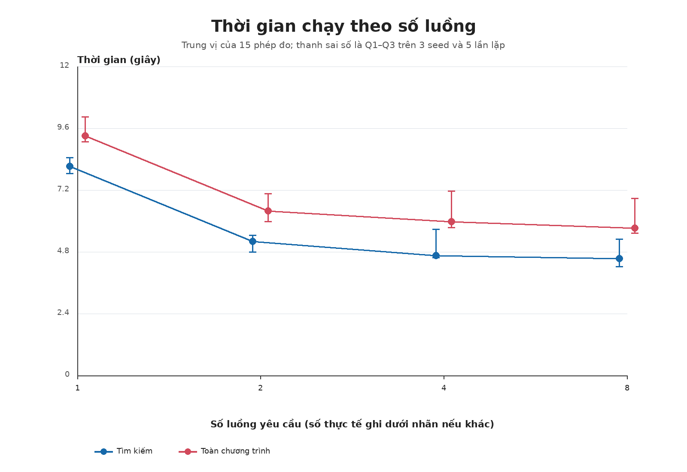
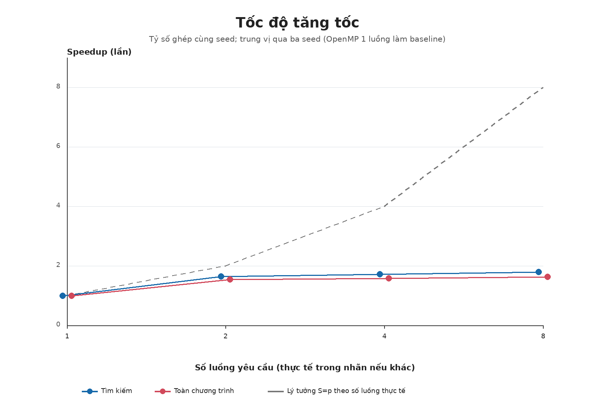
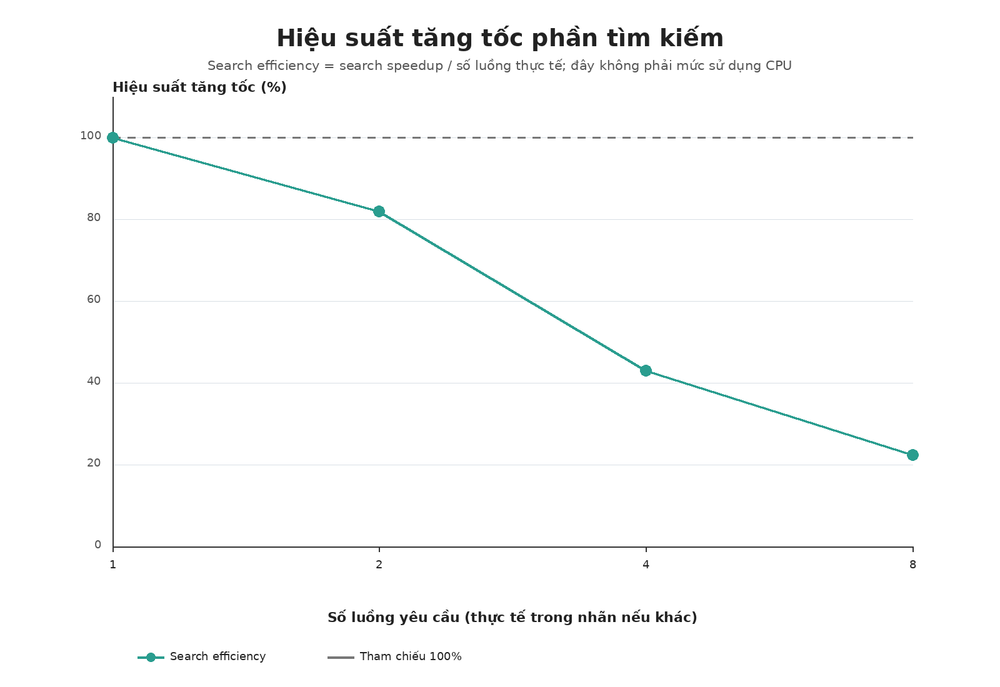
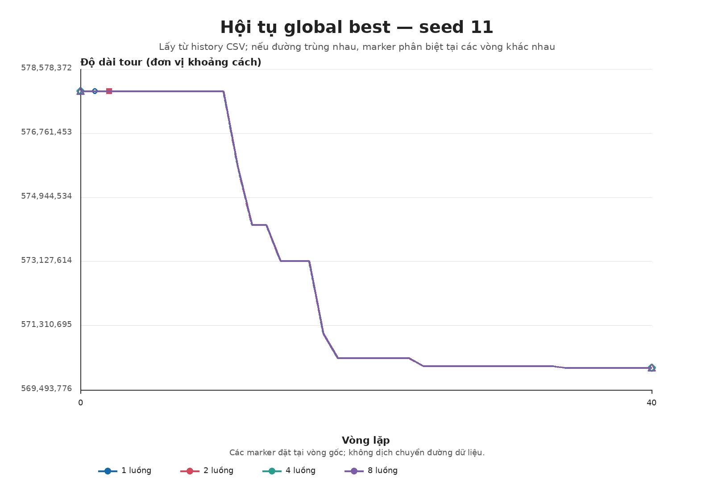

# Kết quả OpenMP: Tnm30001, 30.001 đỉnh

- Instance: [`data/Tnm30001.tsp`](../../data/Tnm30001.tsp), SHA-256 `f19dd50c90d2dff595cddb99dbc7d1c2169a22dd0e67ad0db8fa333aa4c222ca`.
- Binary: `build-omp/faco` (Release, OpenMP).
- Luồng yêu cầu/thực tế: 1, 2, 4, 8 (đủ cả bốn mức).
- Mỗi mức luồng có 3 seed (11, 22, 33) × 3 lần đo; 1 warm-up mỗi mức (không tính thống kê).
- Workload: 32 kiến, 40 vòng, 1 nghiệm khởi tạo, local search tắt; schedule dynamic; cùng cấu hình ở mọi mức luồng.
- Tour, độ dài và lịch sử đã qua kiểm chứng độc lập; benchmark xác nhận kết quả lặp lại khớp giữa các cấu hình luồng cho cùng seed.
- Cấu hình workload đã giảm so với thí nghiệm 2048 (128 kiến, 200 vòng, local search bật), vì instance lớn làm cấu hình đó kéo dài nhiều phút mỗi lượt. Không so sánh trực tiếp chất lượng/thời gian tuyệt đối giữa các instance.

## Tóm tắt

| Luồng | Thời gian search trung vị (s) | Speedup search ghép seed | Hiệu suất (%) | Thời gian toàn phần trung vị (s) | Best length |
|---:|---:|---:|---:|---:|---:|
| 1 | 8.124 | 1.000× | 100.0 | 9.310 | 570120300 |
| 2 | 5.203 | 1.641× | 82.0 | 6.385 | 570120300 |
| 4 | 4.654 | 1.721× | 43.0 | 5.974 | 570120300 |
| 8 | 4.540 | 1.789× | 22.4 | 5.727 | 570120300 |

## Biểu đồ

File `raw.csv`, `summary.csv`, `metadata.json` và toàn bộ JSON/CSV/tour của từng lần chạy được lưu trong thư mục này.
